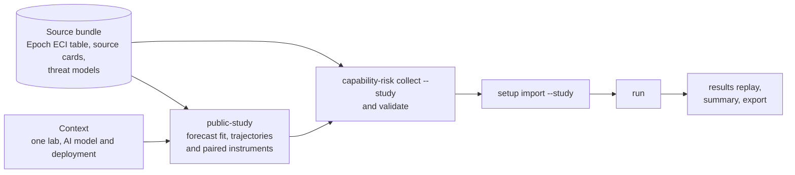

# Workflows

Each `catmodel` command, setup feature and script is in one of three tiers:

- **Main pipeline**: the route from a source bundle to results for a study of one named lab, AI model and deployment along capability trajectories of the public-frontier forecast. The committed study is the [hypothetical frontier lab](../runbook.md#hypothetical-frontier-lab-study).
- **Supported**: maintained and tested outside that route: what-if analysis at fixed capability, authored setups, and maintenance tools.
- **Exploratory**: an alternative for research whose parameters are placeholders or initial estimates. No reference result uses it.

The [glossary](glossary.md) defines the terms, the [runbook](../runbook.md) gives the commands in full, and the [setup, run and results guide](setup-run-results.md) describes the files.

## The main pipeline

1. Freeze upstream evidence in a source bundle (`package build-source-bundle`), including the scenarios' [threat models](threat-models.md).
2. Plan the study (`public-study`): fill the forecast from the bundle's ECI table, fit it and write one pair of context-bound instruments per trajectory node.
3. Collect every instrument at once (`capability-risk collect --study`) and validate the raw responses offline.
4. Import all captures into one setup (`setup import --study`).
5. Run the setup once, then derive results from the immutable capture.

## Command map

| Command | Tier | Purpose |
| --- | --- | --- |
| `package build-source-bundle` | Main pipeline | Freeze authored upstream evidence with checksums and provenance. |
| `capability-forecast public-study` | Main pipeline | Plan a study from a source bundle, a forecast and a context: fill the forecast's releases from the bundle's Epoch ECI table, fit the forecast, place the trajectory nodes (seven by default, `--nodes` for another rule) and write paired public and not-yet-public instruments. `--variant` plans a variant study. |
| `capability-risk build-instrument` | Supported | Render one instrument about one named lab, AI model and deployment, for a fixed-anchor collection or to read the questions. |
| `capability-risk collect`, `validate` | Main pipeline | Freeze prompts and collect answers from the respondent LLMs: every context of a study at once (`--study`), in up to the global `--workers` collector processes, or one instrument (`--instrument`). `--dry-run` calls no provider, and `--answers` reads and fills an [answer table](../runbook.md#answer-table). `validate` replays every raw response against its exact prompt, offline. |
| `answers add` | Supported | Add the stored responses of earlier collections to an answer table. |
| `setup import` | Main pipeline | Replay captured answers into a setup: a study's paired trajectory captures (`--study`), or one fixed-anchor capture (`--run-directory`), whose results are conditional what-if results. |
| `setup build` | Supported | Freeze an authored `setup.json` and `plan.json`, as in the examples. |
| `setup inspect` | Supported | Validate a setup and show its frozen arms, controls and workload. |
| `run` | Main pipeline | Simulate every required arm and save the run capture and initial results. |
| `results replay` | Main pipeline | Reduce a capture again without simulating, at the default and any requested tail levels and, with `--weights`, at other joint-state weights. |
| `results summary` | Main pipeline | Write `summary.md` and `summary.csv` from one results file. |
| `results export` | Main pipeline | Write `export.json` and the capability-scenario files beside copies of the setup, capture and results: the results the capture reduces to or, with `--results`, a replay that reproduces from it. |

## Setup features

| Feature | Tier | Notes |
| --- | --- | --- |
| Poisson incident counts, each incident one member whose loss is split into components | Main pipeline | Every scenario incident has one member and every gate equals one ([methodology](../methodology.md#model-on-one-page)). |
| Cluster counts, member gates, exposure segments and capability response curves | Supported | The engine's general form, in authored setups only ([methodology](../methodology.md#event-populations-and-frequency)). |
| Societal harm (`welfare`) and lab economic loss (`lab_loss::<lab_id>`) views | Main pipeline | Peer measures in every context-bound setup. |
| Public and not-yet-public source-status views | Main pipeline | Produced by `setup import --study`. |
| Authored insurance terms and `financial` views | Supported | Authored setups only; context-bound setups carry no financial inputs. |
| Negative-binomial counts at a fixed variance-to-mean ratio | Exploratory | The `count_family` comparison arm (`FREQ-POISSON`). |
| Shared gamma intensity and Gaussian count-copula dependence stresses | Exploratory | Authored setups only; each runs with a matched independent control (`DEP-RESIDUAL-FACTOR`). |

## Scripts

All scripts are supported tools.

| Script | Purpose |
| --- | --- |
| `scripts/run_hypothetical_lab_study.py` | Plan, dry-run or collect the hypothetical-lab study end to end, with each `--variant NAME` the variant study it names; `--resume` continues an interrupted run ([runbook](../runbook.md#running-the-hypothetical-lab-study)). |
| `scripts/conditioning_pilot.py` | Plan, collect and analyse the optional [conditioning pilot](../runbook.md#conditioning-pilot), which checks whether answers move with the capability path. |
| `scripts/respondent_calibration.py` | Collect known-answer count questions (`collect`) and fit the respondent spread `k` and common level bias `b` (`fit`), a diagnostic that no setup reads ([runbook](../runbook.md#respondent-spread-calibration)). |
| `scripts/calibration_seeds/` | Reassemble the committed [respondent spread seed package](../data/calibration/respondent_spread/README.md) from its archived resolver inputs, or retrieve a new dated vintage. |
| `scripts/probe_output_ceilings.py` | Ask each selected model of a profile for one word at its recorded output ceiling, with one live call per model ([runbook](../runbook.md#3-collection-settings-and-validation)). |
| `scripts/backtest_public_frontier.py` | Score candidate pace shapes by rolling-origin pinball loss on a forecast's releases. |
| `scripts/render_example_questions.py` | Regenerate the [example questions](example-questions/README.md) from the planned hypothetical-lab study. |
| `scripts/validate_scenario_library.py` | Validate the scenario library, the source cards' scenario list and the threat-model register, and check the derived catalog, taxonomy explorer and documented counts; `--fix` regenerates them ([adding a scenario](adding-a-scenario.md)). |
| `scripts/threat_model.py` | Print a scenario's research brief, check a draft threat model and count a blind candidate's coverage of a reference ([threat models](threat-models.md)). |
| `scripts/generate_results_schemas.py` | Regenerate the results files' JSON Schema documents under `contracts/results/`. |
| `scripts/trace_collection.py`, `scripts/collection_timing.py` | Development tools: an offline trace of a study's collection against a fake provider with synthetic answers, and timing aggregates of a collected study's stored attempts. |
| `scripts/check_incident_wheel.py`, `scripts/check_sdist.py` | Checks of the built wheel and source distribution ([TESTING.md](../TESTING.md)). |
| `scripts/check_dependency_pins.py` | Development and CI check of dependency pins ([TESTING.md](../TESTING.md)). |
| `scripts/offline_demo.py` | Run one scenario from frozen questions to a results summary offline, on synthetic answers from a fake respondent ([README](../README.md#quickstart)). |
